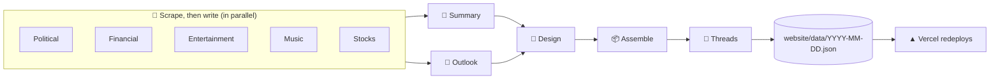

# 🌍 Daily World Diary

**An AI newsroom that writes, designs and publishes a new edition of the world every morning.**

Every day at 9am New York time, a pipeline of AI agents reads the day's news, markets and music, writes a digest, links today's stories to the ones it has been following all week, and then *designs the page itself*: a new look, built from that day's news, so no two days look the same.

🔗 **Live:** [daily-world-diary-v2.vercel.app](https://daily-world-diary-v2.vercel.app)

---

## ✨ What it does

### 📰 A full edition, written fresh every day
Six sections every morning, each from real sources scraped that day:

| | Section | Source |
|---|---|---|
| 🏛️ | Political News | Google News: Politics + World |
| 💼 | Financial News | Google News: Business |
| 🎬 | Entertainment News | Google News: Entertainment |
| 🎧 | Music Releases | Spotify Web API: the week's new albums and singles |
| 📈 | Stock Analysis | Yahoo Finance: IPOs, indices, sectors, major stocks, movers |
| 🔭 | Outlook | What to watch next, drawn from the other five |

Plus a short **summary** of the day at the top of the page.

### 🎨 Every day gets its own design
After the edition is written, one more AI call acts as **art director**. It reads the whole day and designs the page:

- 🧱 **Structure:** one of **4 header styles**, and for each section one of **10 card components** (banner, stat, timeline, lede, split, tile and more) in one of **6 layouts** (grid, feature, masonry, horizontal rail and more)
- 🖌️ **Look:** its own palette, typography (12 fonts to choose from) and ornaments, written as CSS
- 🔁 **Variety, enforced:** it sees the last four days' designs and must use at least 3 card types and 2 layouts, and a different header and headline font from yesterday
- 🏷️ It names the theme and explains it, e.g. *"Oil-Slick Volatility"* or *"Circuit Breakers"*, shown under the summary

### 🧵 Story threads across days
Each night the stories are matched against the past week's. When a story keeps developing, its card gets a tag like **`Day 3 · Netflix's leadership shakeup`**, and a thread page follows that story day by day. Earlier entries are never rewritten.

### 📊 Live market sparklines
The Stock Analysis section opens with **16 mini charts**, one for each index (S&P 500, Dow, Nasdaq, Russell 2000, VIX) and SPDR sector, drawn straight from Yahoo's closing prices. No AI touches the numbers.

### 🎵 Spotify players inline
Every release in Music Releases comes with an **embedded Spotify player**, so you can listen while you read.

### 🔗 Every claim is linked
Sentences carry small citation tags linking to the source article. **The model never writes a URL:** it cites numbered items it was given, and only those scraped links reach the page.

### 🌗 Five reader themes
Prefer a fixed look? A theme menu in the corner offers **Today's design** (the default) or one of five themes:
☀️ Light · 🌙 Dark · 📜 Sepia · 🌌 Midnight · ⚫ High contrast

Your choice is remembered, and the page renders in it straight away, with no flash.

### 📱 Works everywhere
Responsive down to 320px phones, light and dark mode, a sticky contents strip on mobile and sidebar on desktop, active-section highlighting, and a back-to-top link.

---

## 🛡️ Built to be safe with AI output

Model output goes straight into the page, so it's treated as untrusted:

- 🧼 **HTML** is rendered from Markdown and passed through an allowlist sanitizer (`nh3`): no scripts, no event handlers, `http(s)` links only.
- 🎨 **CSS** from the design step is parsed with `tinycss2` and **rejected** unless:
  - every selector is scoped to the diary page;
  - nothing loads an external resource (`url()`, `@import` and `@font-face` are banned);
  - nothing hides content or uses `position: fixed`;
  - every colour pair meets **WCAG contrast** in every colour scheme the theme defines.

  A rejected design goes back to the model with the exact reason, up to 5 retries. If every attempt fails, the page falls back to the base design, so **a bad design can never lose an entry**.
- 🔑 **An OpenRouter key problem** (bad key, no credits, spend cap) stops the run with nothing written, rather than publishing a half-empty edition.

---

## ⚙️ How it works



1. ⏰ **GitHub Actions** runs at 9am New York time.
2. 🐍 A **LangGraph** pipeline in Python scrapes each source, then has a model write each section from only that material.
3. 🤖 Every model call goes through **OpenRouter**, with the model set by one variable (`OPENROUTER_MODEL`).
4. 💾 The finished entry is committed to the repo as JSON. Entries are write-once.
5. 🚀 **Vercel** sees the commit and redeploys the **Next.js** site, which reads the JSON files.

💸 **Cost:** about **half a US cent per day** in model calls, measured from each entry's recorded usage.

---

## 🧰 Tech stack

| Part | Tools |
|---|---|
| 🐍 Backend | Python 3.12, LangGraph, OpenAI SDK (via OpenRouter), yfinance, nh3, tinycss2, uv |
| ⚛️ Frontend | Next.js 16 (App Router), React 19, Tailwind CSS 4, `next/font` |
| ☁️ Infra | GitHub Actions (schedule), Vercel (hosting) |
| ✅ Tests | pytest: 144 tests, no network |

---

## 🚀 Running it yourself

### 1. Secrets
Set these in **Settings → Secrets and variables → Actions**, or in `backend/.env` for local runs:

| Name | Kind | What |
|---|---|---|
| `OPENROUTER_API_KEY` | secret | your OpenRouter key |
| `SPOTIFY_CLIENT_ID` | secret | Spotify app client ID |
| `SPOTIFY_CLIENT_SECRET` | secret | Spotify app client secret |
| `OPENROUTER_MODEL` | variable | e.g. `deepseek/deepseek-v4-flash-0731` |

### 2. Generate an entry
```bash
cd backend
uv run python -m diary.generate --date 2026-10-26            # write one day
uv run python -m diary.generate --date 2026-10-26 --force    # regenerate it
OPENROUTER_MODEL=stub uv run python -m diary.generate --dry-run   # no network, nothing written
```
Regenerating several days? Go **oldest first**, so each day's threads and design can see the day before.

### 3. Run the site
```bash
cd website
npm install
npm run dev
```
Then open [localhost:3000](http://localhost:3000).

### 4. Test
```bash
cd backend
uv run pytest
```

---

## 🗂️ Project layout

```
backend/
  diary/
    sources/      🔎 Google News, Spotify, Yahoo Finance scrapers
    prompts.py    📝 the seven writing agents
    agent.py      🤖 one OpenRouter call per agent, citations → links
    design.py     🎨 the art director: components, CSS validation, retries
    threads.py    🧵 links stories across days
    pipeline.py   🔀 the LangGraph graph
    generate.py   ▶️  the CLI
  DESIGN.md       📐 the full design doc
website/
  data/           💾 one JSON file per day
  src/app/        🌐 pages: /diary/[date], /threads/[id], /calendar, API routes
  src/components/ 🧩 cards, sparklines, contents, theme menu
.github/workflows/daily-diary.yml   ⏰ the 9am run
```

📐 For the reasoning behind every piece, read [`backend/DESIGN.md`](backend/DESIGN.md).
