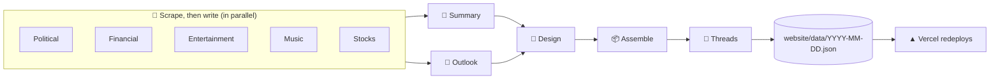

# 🌍 Daily World Diary

An AI newsroom that writes, designs and publishes a new edition of the world every morning.

## ✨ Features

- 📰 **Daily edition**: politics, finance, entertainment, sports, music, markets and an outlook, written from news scraped that morning (Google News, ESPN, Spotify, Yahoo Finance)
- 🎨 **A new design every day**: an AI art director picks header styles, card components and layouts, then writes the CSS, and must look different from yesterday
- 🧵 **Story threads**: developing stories are linked across days ("Day 3 · Netflix's leadership shakeup"), each with its own timeline page
- 📊 **Market sparklines** for every index and sector
- 🎵 **Spotify players** for each new release
- 🔗 **Cited sources**: every link comes from scraped material, never from the model
- 🏠 **Home page**: the latest edition and a calendar of every edition, in five themes (Light, Dark, Sepia, Midnight, High contrast) that switch instantly
- 🛡️ **Safe with AI output**: sanitized HTML, and CSS that is validated for scope, external resources and WCAG contrast, then retried with feedback

## ⚙️ How it works



GitHub Actions runs the LangGraph pipeline at 9am New York time, using models via OpenRouter. The entry is committed as JSON, and Vercel redeploys the Next.js site. It costs about half a cent a day.

## 🚀 Run it

Set `OPENROUTER_API_KEY`, `SPOTIFY_CLIENT_ID` and `SPOTIFY_CLIENT_SECRET` as secrets, and `OPENROUTER_MODEL` as a variable (or put them in `backend/.env`).

```bash
cd backend && uv run python -m diary.generate --date 2026-10-26
cd website && npm install && npm run dev
cd backend && uv run pytest
```

📐 The full design is in [`backend/DESIGN.md`](backend/DESIGN.md).
